# Pimi


**Your swarm’s best friend.**

Chat with your agents, track their work, and review the changes in one app.

[Downloads](https://1ikeadragon.github.io/pimi/) · [Android APK](https://github.com/1ikeadragon/pimi/releases/download/pimi-android-v0.16.10-preview.1/Pimi-Android-arm64.apk) · [Release notes](https://github.com/1ikeadragon/pimi/releases/latest)

Pair Pimi for Android with your desktop to chat, track tasks, and review changes on your phone. [Android setup and builds](docs/android.md#pimi-apk) · [Self-host Pimi Relay](https://github.com/1ikeadragon/pimi-relay)

The desktop installers include the daemon and the `pimi` CLI. For remote pairing, configure your own relay or connect over a VPN.

## Chat and Tasks

Ask an agent to track a task or send a few agents to explore it. Queue a follow-up or fork a chat to another provider.

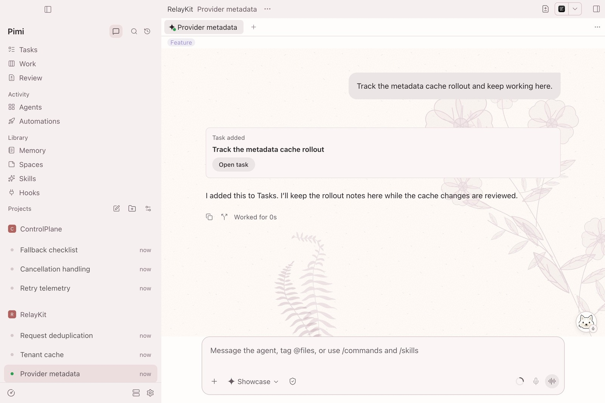

Linked work moves tasks along automatically. You can move cards yourself and read the agents’ reports from the task.

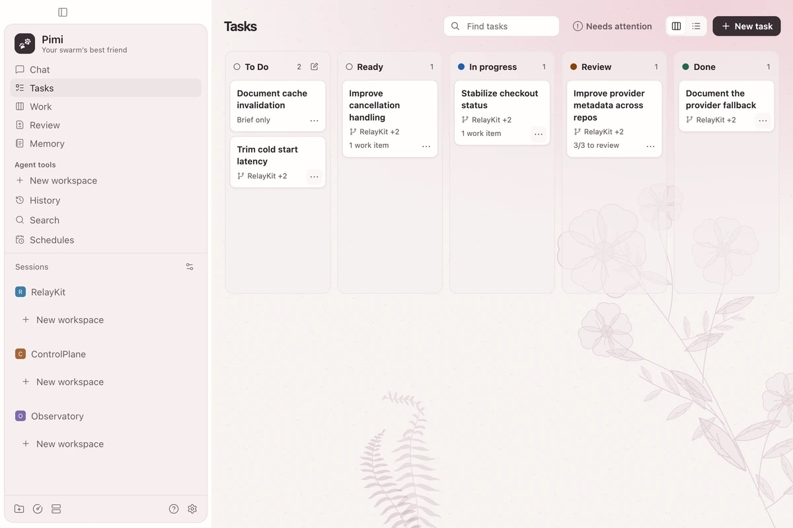

Click Pimi and say “Show my open PRs” or “Start a chat with the arXiv paper in Spaces called Attention Is All You Need.”

## Watch the swarm

Watch six sessions at once in **Agent grid** on a wide window. **Work** tracks the branches behind them.

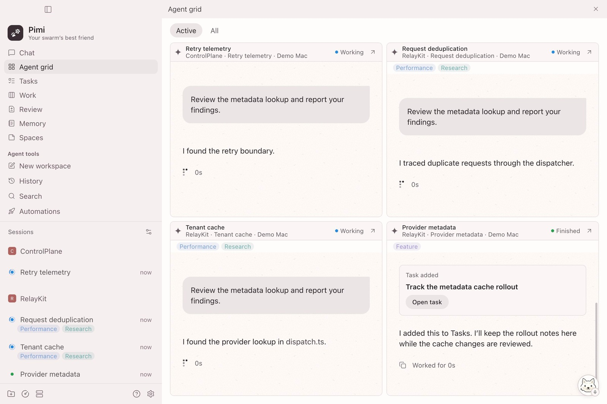

## Review together

Compare diffs across worktrees and repositories. Open **PRs** to see review requests, checks, and pull request details.

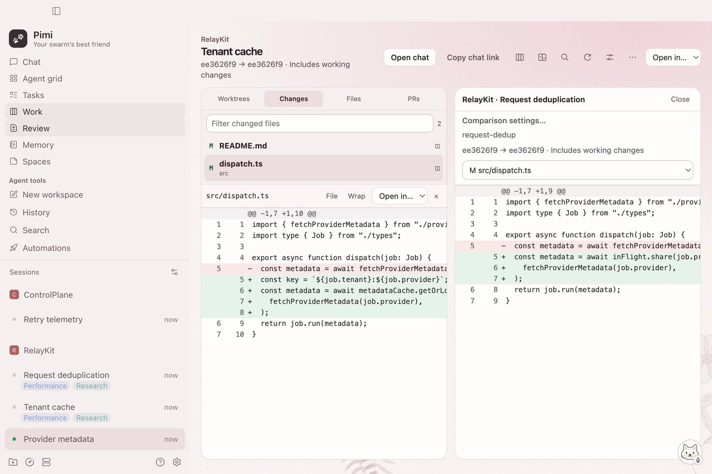

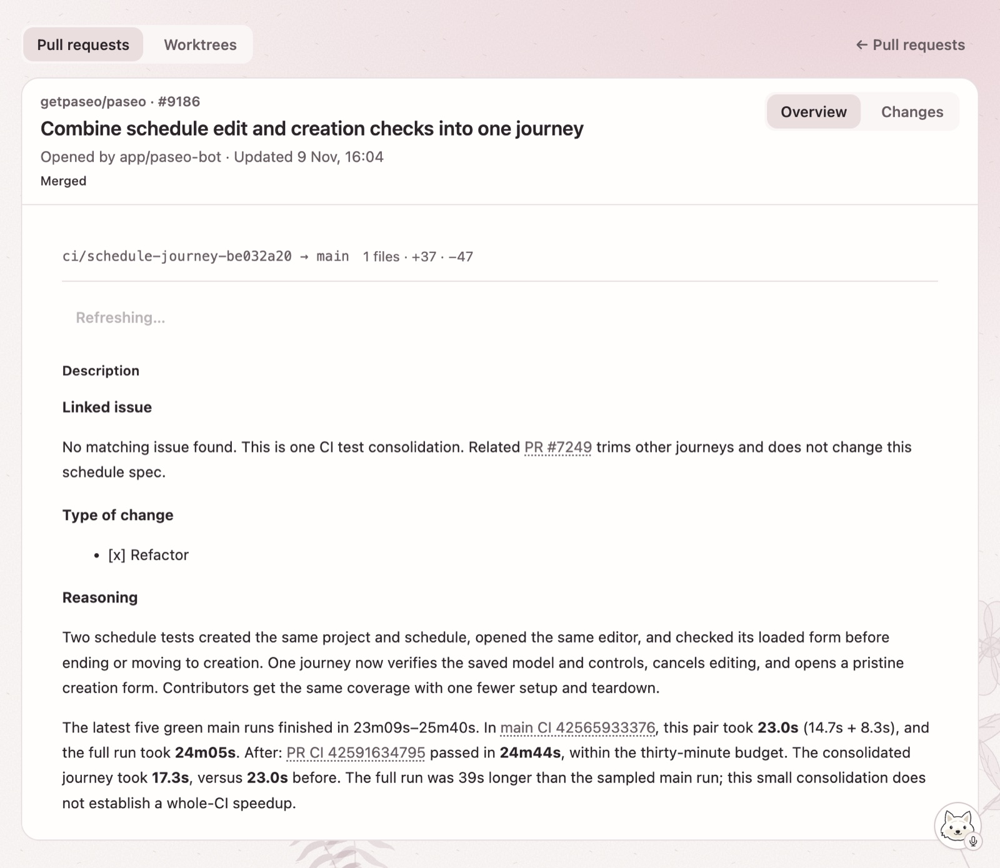

<details>
<summary>Setup, Work, Memory, Spaces, Automations, Usage, and Library</summary>

**Setup** gets you from the welcome screen to your first chat.

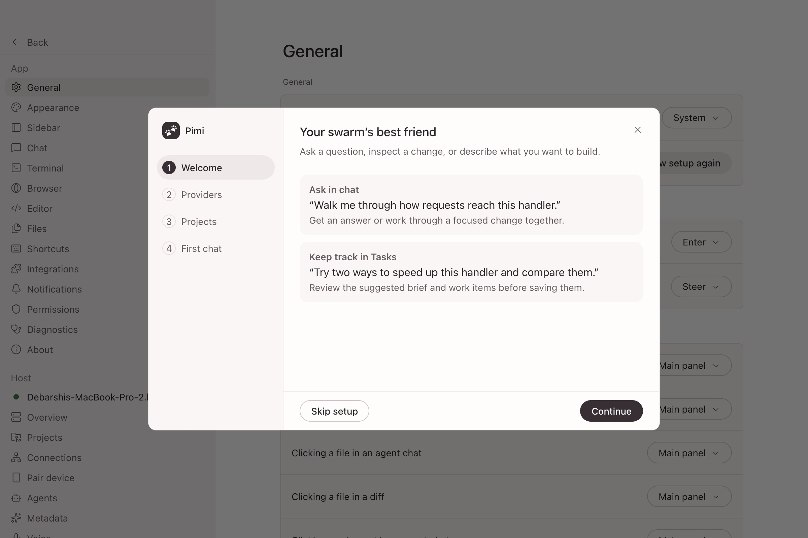

**Work** shows which branches are ready to start, in progress, or ready for review.

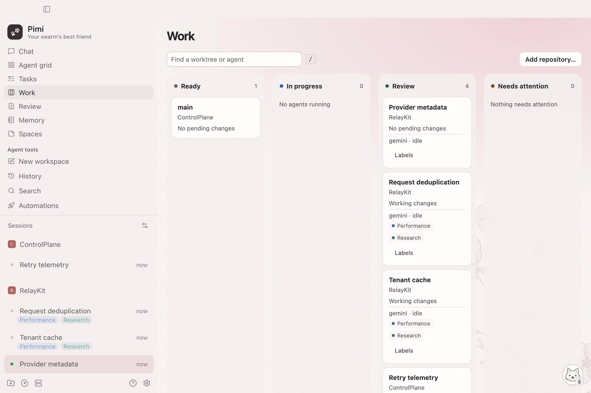

**Memory** keeps project notes available across providers.

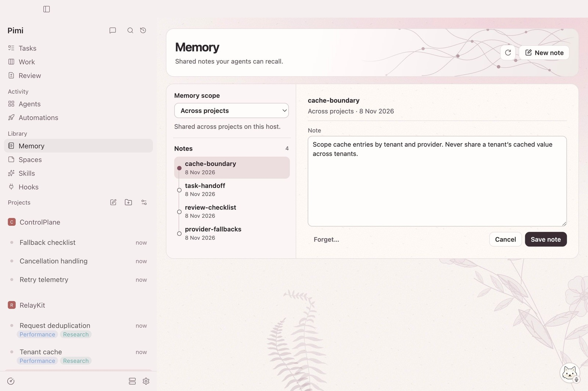

**Spaces** is a scratchpad for links, images, and notes. Search it locally, open papers in Pimi, or give an agent a card ID.

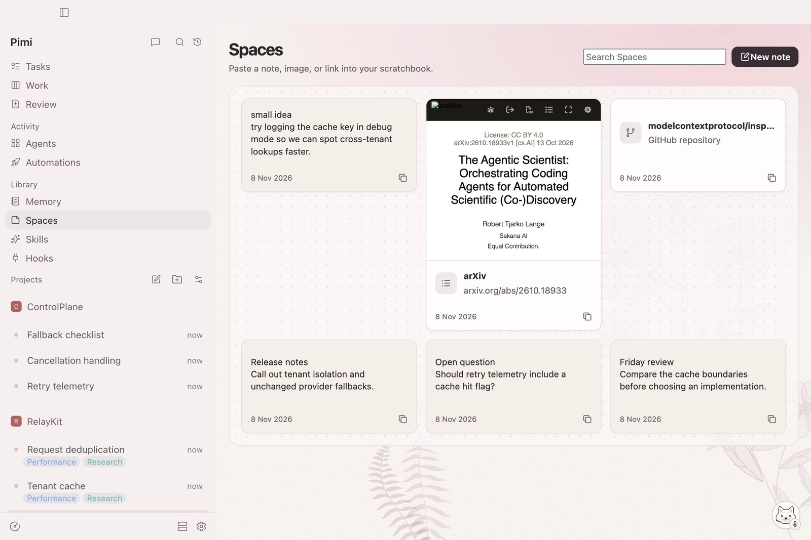

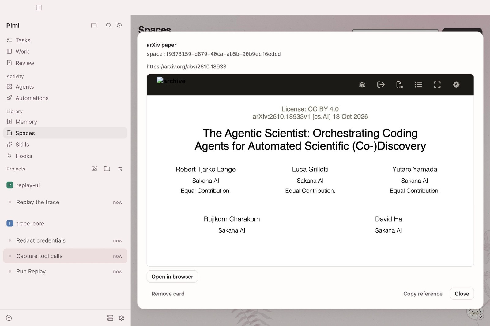

**Automations** runs jobs on a schedule and keeps their results in chat.

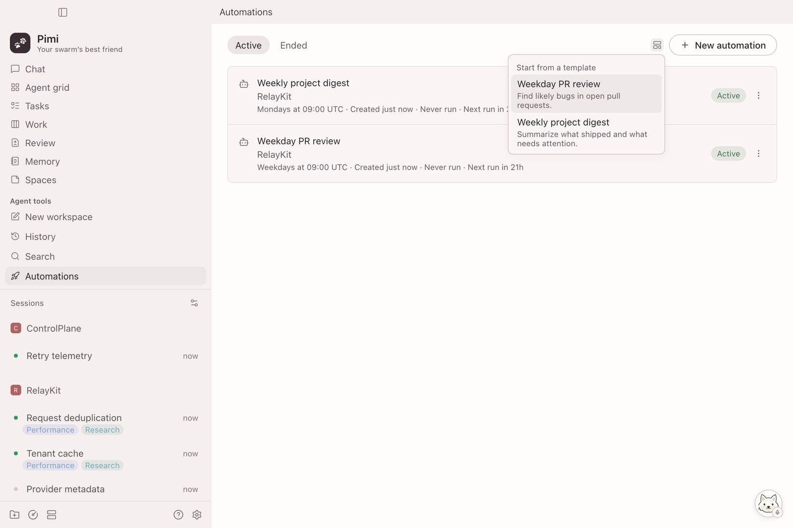

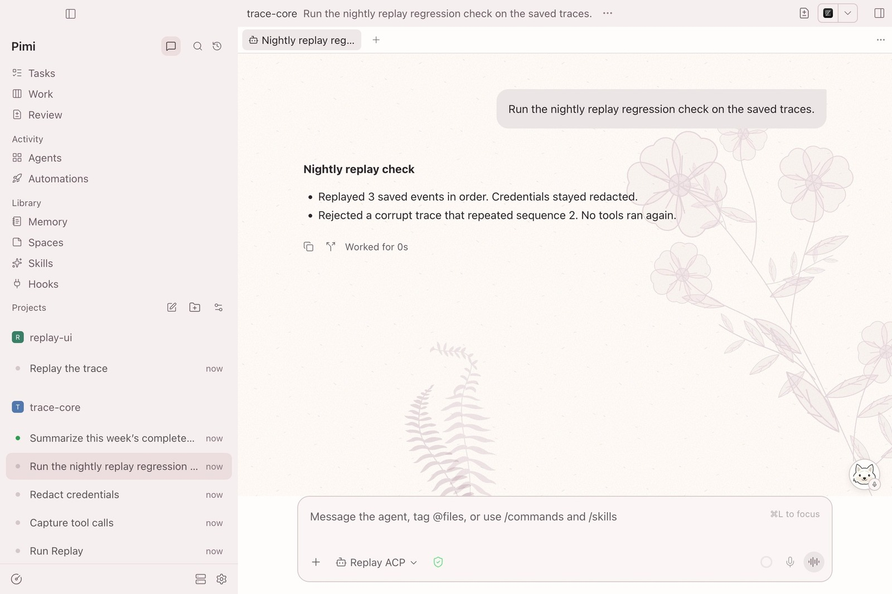

**Usage** shows context and recorded compactions. Run `/context` in Claude Code for a token breakdown. **Recap** brings together finished tasks and merged PRs.

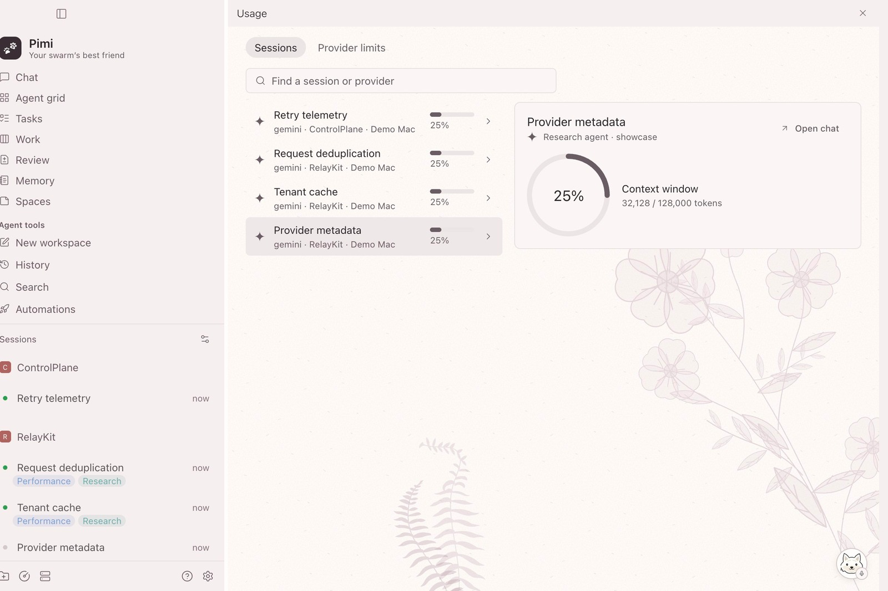

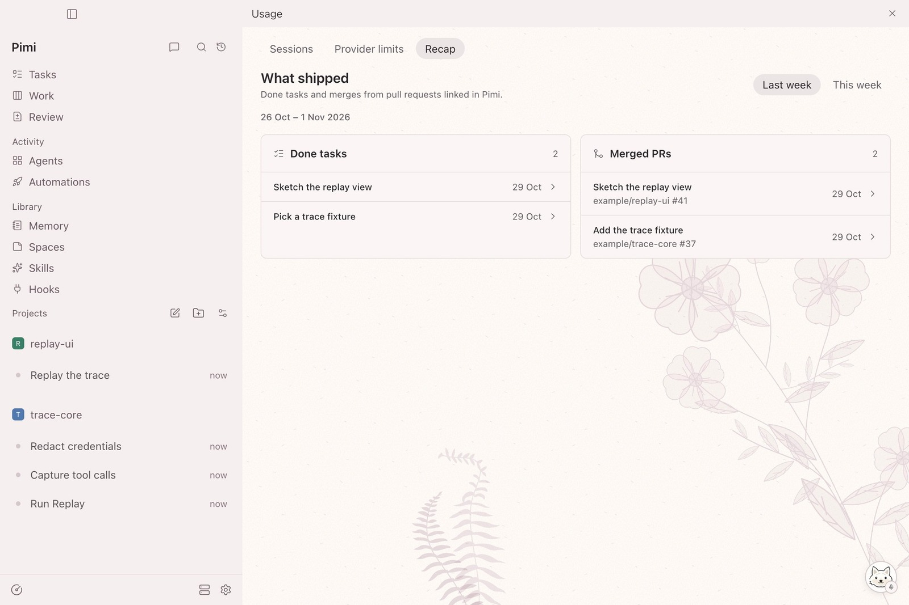

**Library** is where you manage skills for your agents.

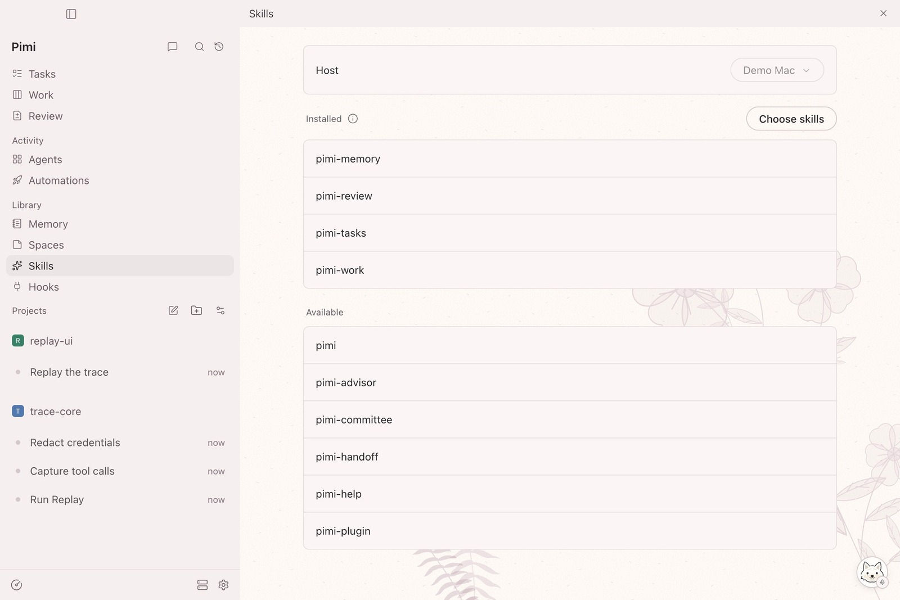

</details>

Screenshots show Pimi 0.16.5 with sample projects and activity.

## Build from source

Use the Node version in [`.tool-versions`](.tool-versions).

```sh
npm ci
npm run pimi:package:mac
```

On Windows, run `npm run pimi:package:win` after `npm ci`. Builds land in `packages/desktop/release-pimi/`. The macOS app is ad-hoc signed. The Windows installer is unsigned.

[Dev setup](pimi/README.md) · [Security and network activity](SECURITY.md)

## Credits

- Pimi is a fork of [Paseo](https://github.com/getpaseo/paseo), by Mohamed Boudra and contributors. It uses [Electron](https://github.com/electron/electron), [Git](https://github.com/git/git), and [GitHub CLI](https://github.com/cli/cli).
- Spaces search uses [Potion Base 2M](https://huggingface.co/minishlab/potion-base-2M) and [Hugging Face Tokenizers](https://github.com/huggingface/tokenizers.js).
- Blush artwork is adapted from Sophia L. Crownfield’s [_Studies of Ferns_](https://commons.wikimedia.org/wiki/File%3ADrawing%2C_Studies_of_Ferns%2C_early_20th_century_%28CH_18345009%29.jpg).

[Apache 2.0 license](LICENSE)
