# Pimi


**Your swarm’s best friend.**

Start with a chat, give your agents separate Git worktrees, and review their changes together. A Pimi task can track one feature across several repositories.

[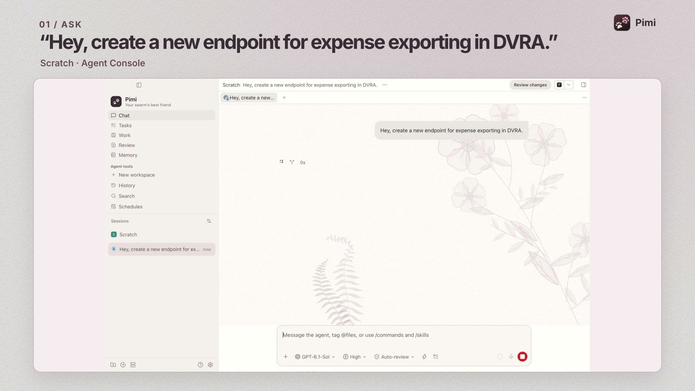](assets/pimi/promo.mp4)

This real Pimi run starts with a chat request from an empty Scratch workspace. Codex finds DVRA, adds `GET /api/expenses/export`, and checks that each role gets the right CSV rows. The videos condense the wait between steps. [Watch the longer walkthrough](assets/pimi/dvra-expense-export-demo.mp4)

## Start in chat

Pimi opens in Agent Console. On first launch, setup helps you connect an agent provider, set up GitHub or GitLab, add a project, and start a conversation. Use the same sidebar to move between Chat, Tasks, Work, Review, and Memory in the main window.


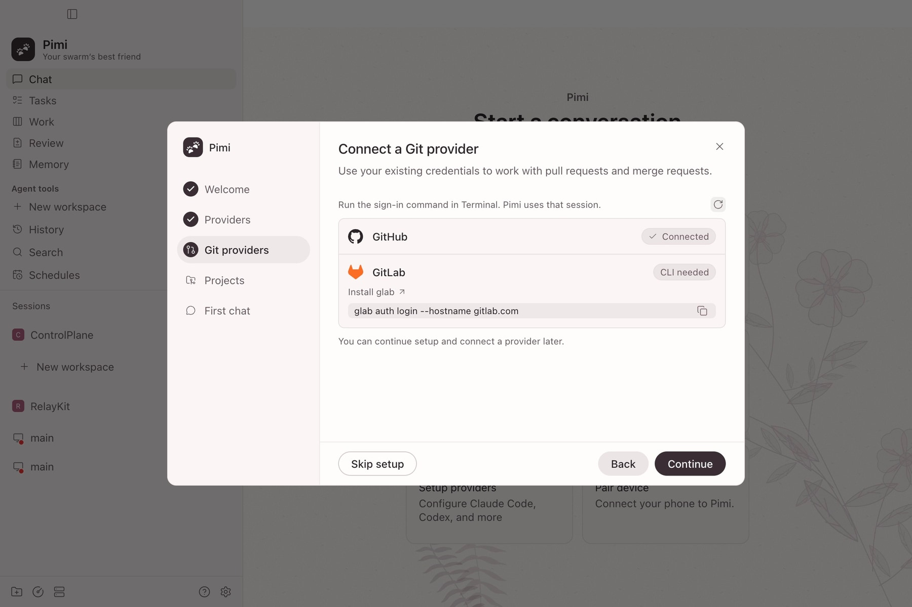

New chats get a short title based on the first message when a metadata provider is available. With **Agent tools** enabled, agents can also suggest a task. **Review task draft** opens the brief and proposed work items for you to edit and save.

The change count above the composer shows changed files, additions, and deletions. Click it or the diff icon in the header to open Review for the same checkout, including files the agent has just created.

While an agent is running, use the queue icon to hold a follow-up for its next turn. Queued messages appear above the composer, where you can edit, remove, or steer with one immediately.

To hand a conversation from Claude Code to Codex, or back again, use the fork icon under a response and choose **Fork with another provider**. Pimi opens a draft in the same workspace with the selected provider and a **Chat history** attachment. The fork uses the selected response as its checkpoint and sends the attachment with your first message.

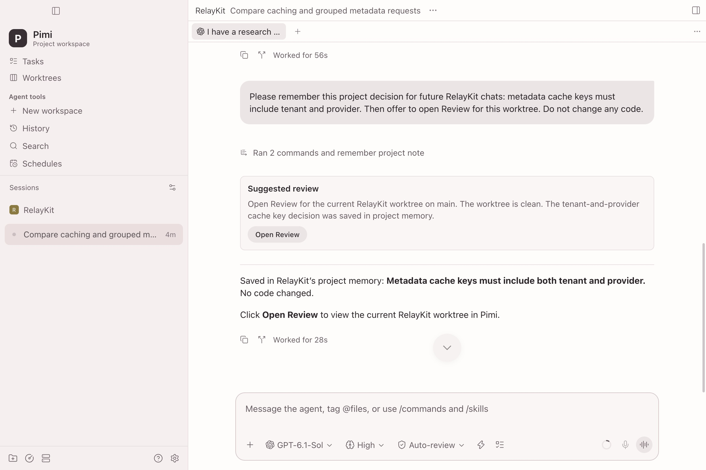

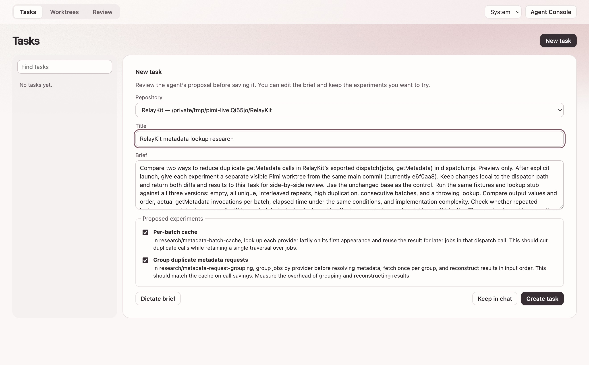

## Follow work across repositories

This example improves provider metadata across RelayKit, ControlPlane, and Observatory. Each work item can link an existing checkout or start an agent in a new worktree at its repository’s pinned commit.

Tasks has its own Kanban: **Backlog**, **Ready**, **In progress**, **Review**, and **Done**. Linked work and agent reports move a task as far as Review. Drag a card or choose a stage to take over, then select **Auto** to follow progress again. You decide when a task is done.


### 1. Capture the question

Type or dictate the brief. Dictation appears at the bottom of Tasks, and you can edit the transcript before saving.

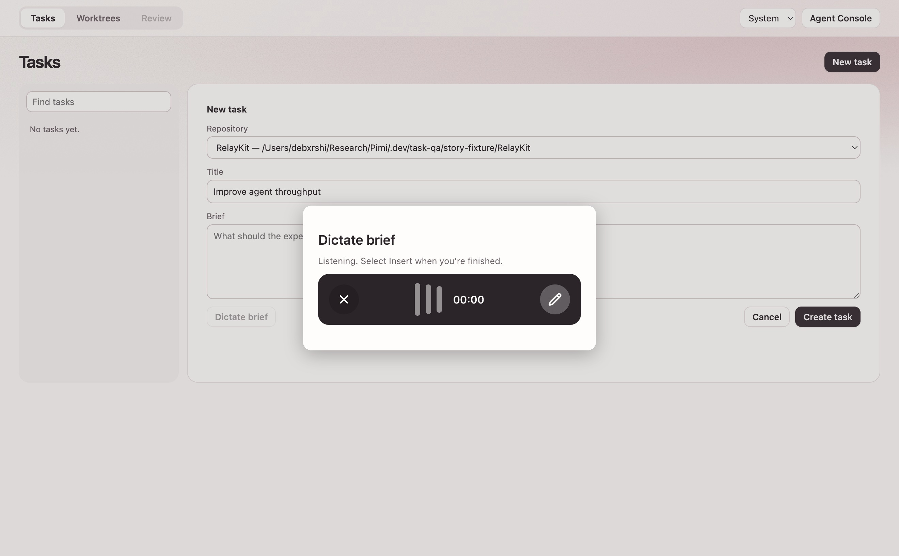

### 2. Choose what to try

Attach the repositories, then write work items or ask your configured model to suggest two. Assign each draft to a repository before choosing **Start agents**.

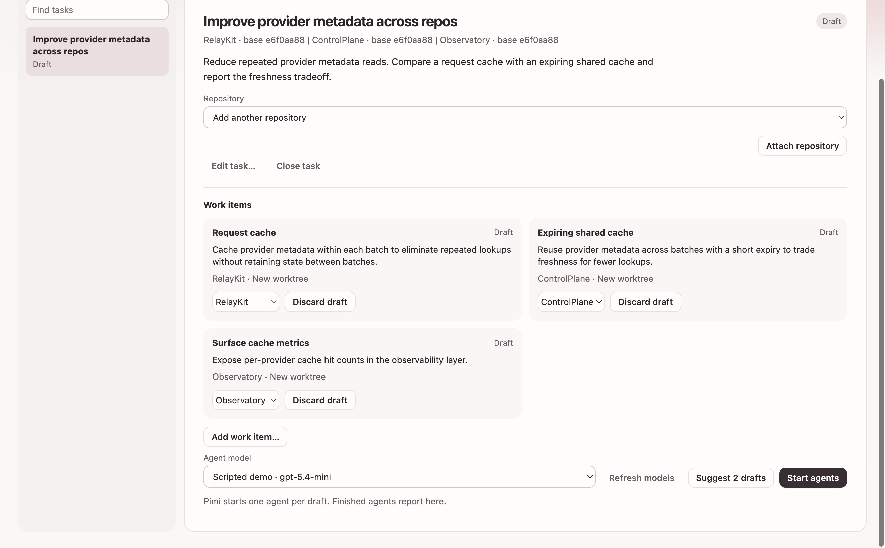

### 3. Follow the worktrees

Auto-Kanban updates as Git and agent activity change. The agents’ final reports appear under their work items as they finish. An open diff stays where you left it until you ask to reload it.


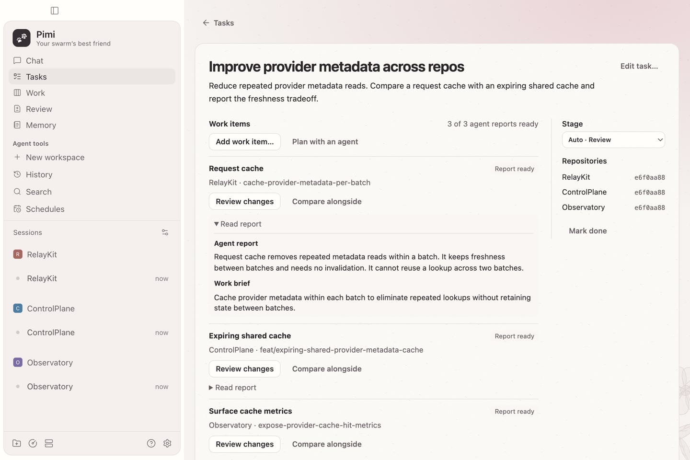

### 4. Ask a follow-up

Open the worker’s conversation or copy a link to it. An agent can offer to open **Review** for its checkout when it has work ready.


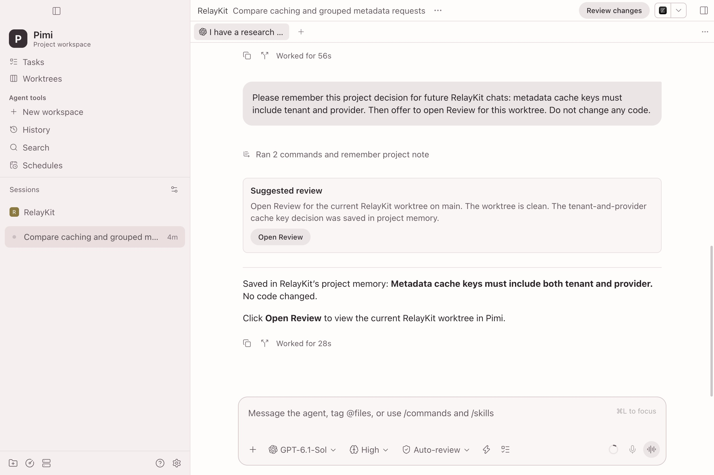

### 5. Read the diff

Open **Review** and choose a worktree, or select **Compare alongside** from a work item. Each side shows its own repository and base. Use **Find in open diffs** or `⌘F` to search the visible patches. Choose an editor under **Open in…** to open the worktree or jump from a diff to the file and line.


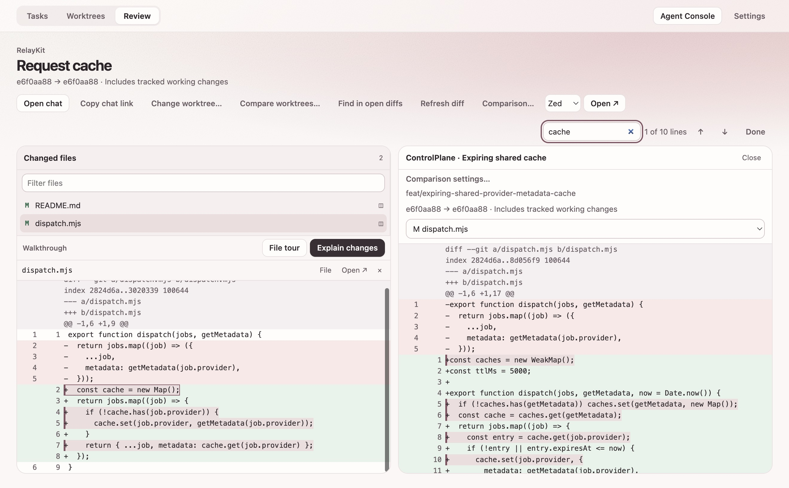

**Explain changes** adds notes tied to changed lines. **File tour** walks the changed files without calling a model.

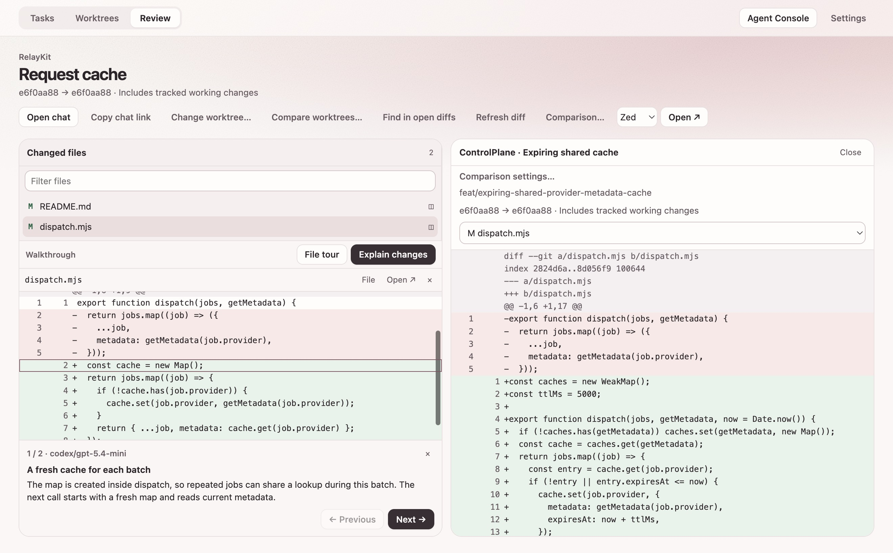

### Choose an appearance

Choose an appearance in **Pimi → Settings → Appearance**. Blush pairs rose botanical linework with a fern silhouette, Paper has warm fibers, and Dark uses charcoal surfaces with fine graphite grain. **System** follows the Mac’s light or dark appearance. Code and controls keep solid backgrounds.

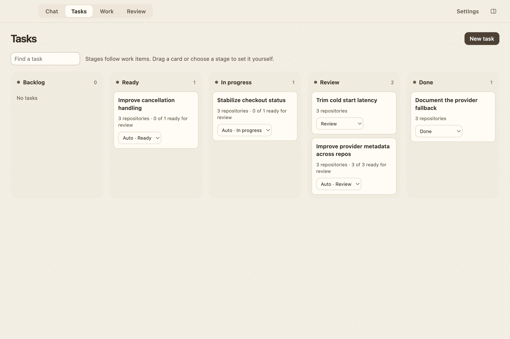

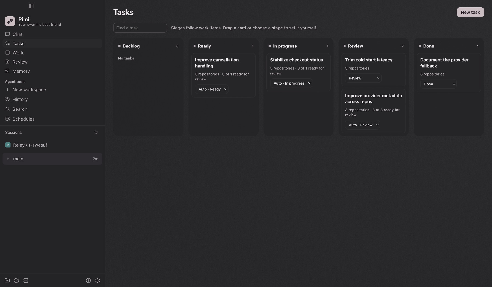

### Find saved memory

Open **Memory** from Home or the sidebar. **Across projects** shows notes agents can recall across projects on this host. Choose a project to see its own notes, shared across its worktrees. You can add, edit, and forget notes from either scope.


## What you can do

- **Share memory across providers.** With Agent tools enabled, ask an agent to remember a decision, convention, or preference. Notes default to the project scope. Ask explicitly to remember a preference across projects when you want it shared on this host. Notes enter a provider’s context when recalled.
- **Compare findings.** Read agent reports, return to their chats, and review their changes against each repository’s pinned base.
- **See what needs you next.** Auto-Kanban sorts worktrees into **Ready**, **In progress**, **Review**, and **Needs attention** from Git and live agent activity. Search by repo, branch, or agent. Pimi remembers repositories you add.
- **Review code in place.** Compare working changes, a branch against a base ref, or a GitHub pull request. Open two files side by side, switch between diff and source, or compare a second worktree.
- **Follow changes line by line.** File Tour walks through the changed files. Explain Changes uses your configured provider to generate short notes tied to added lines. Notes stay below the diff so you can read both together.
- **Preview and edit.** Open a healthy workspace service from its review. Jump from a reviewed line to your chosen editor when the checkout matches.
- **Manage agents.** Open Agent Console for sessions, terminals, workspace services, voice, and provider settings.
- **Choose an appearance.** In Settings, follow macOS automatically or switch between Blush, Dark, and Paper.

Press `/` to focus the search field for the current view. In review, use `[` and `]` to move through files or through an open tour.

## Run on macOS

Build from source on Apple silicon with Git and the Node version in [`.tool-versions`](.tool-versions). GitHub CLI handles pull request lookup.

```sh
npm ci
npm run pimi:package:mac
open packages/desktop/release-pimi/mac-arm64/Pimi.app
```

The build creates a local, non-notarized app bundle. Follow setup to start a chat, or open **Tasks** directly from the sidebar. A brief can be saved before you attach a repository. In **Work**, choose **Add repository…** to add an existing Git checkout.

[Development commands, provider selection, and audit notes](pimi/README.md)

## Credits

- **Paseo**, by Mohamed Boudra and contributors, is Pimi’s upstream. Pimi inherits its agent runtime, SDK, desktop shell, syntax highlighter, and editor launcher. [Upstream source](https://github.com/getpaseo/paseo)
- **Electron** provides the desktop runtime. [Electron source](https://github.com/electron/electron)
- **Git** provides worktrees and comparisons. **GitHub CLI** supplies pull request metadata and authentication. [Git source](https://github.com/git/git) · [GitHub CLI source](https://github.com/cli/cli)
- The Blush fern silhouette is adapted from Sophia L. Crownfield’s *Studies of Ferns*, Cooper Hewitt, Smithsonian Design Museum. [Public-domain artwork](https://commons.wikimedia.org/wiki/File%3ADrawing%2C_Studies_of_Ferns%2C_early_20th_century_%28CH_18345009%29.jpg)
- The launch film uses [Brag](https://github.com/latent-spaces/brag) and [Hyperframes](https://github.com/heygen-com/hyperframes). Music is an excerpt from _Happy Beats / Business Moves Vol. 1_ by [Sascha Ende](https://ende.app/en), trimmed and faded. [CC BY 4.0](https://creativecommons.org/licenses/by/4.0/)

Pimi retains Paseo’s copyright and Apache 2.0 license. Third-party components retain their own licenses. [License](LICENSE)
