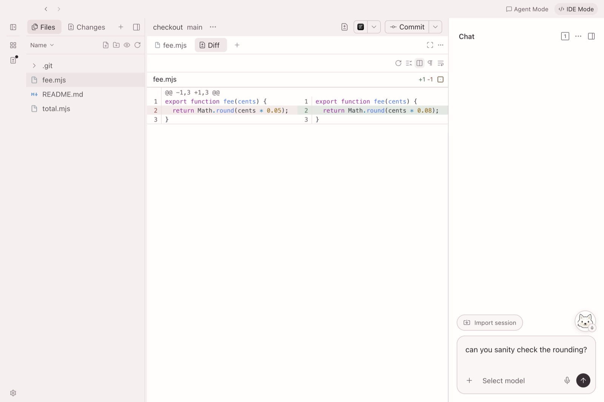

# Pimi


**Your swarm’s best friend.**

Chat with your agents, track their work, and review the changes in one app.

[Downloads](https://1ikeadragon.github.io/pimi/) · [Android APK](https://github.com/1ikeadragon/pimi/releases/download/pimi-android-v0.17.8-preview.1/Pimi-Android-arm64.apk) · [Release notes](https://github.com/1ikeadragon/pimi/releases/latest)

Replacing Paseo? [Keep your sessions and plugins](docs/paseo-migration.md).

## Chat and Tasks

Ask an agent to track a task or send a few agents to explore it. Queue a follow-up or fork a chat to another provider.


Linked work moves tasks along automatically. You can move cards yourself and read the agents’ reports from the task.


Click Pimi and say “Show my open PRs” or “Start a chat with the arXiv paper in Spaces called Attention Is All You Need.”

## Watch the swarm

Watch six sessions at once in **Agent grid** on a wide window. **Work** tracks the branches behind them.


## Edit beside your agents

Choose **IDE Mode** in the title bar. Open a file from Explorer, edit it beside chat, and check its diff or Git blame without leaving the workspace.

Use **Search codebase** in the Command Center to find code by behavior or identifier. Select a result to jump to its line. The index builds on the workspace host using the bundled search model.



## Review together

Review opens to your pull request inbox. See requests and your own open PRs, or switch to **Worktrees** to compare changes across repositories.


Screenshots use sample projects and activity.

## Use Pimi from your phone

Install Pimi Desktop and the [Android APK](docs/android.md#pimi-apk). Run Pimi Relay on a server you control, point your desktop at it, and scan the desktop’s **Pair a device** QR code in the Android app. Keep the desktop awake, set a daemon password, and keep the QR code private.

One relay can serve all your computers or a group of friends. Pair each computer separately and share the relay address with friends who want to pair their own computers. [Personal and team setups](https://github.com/1ikeadragon/pimi-relay#who-can-share-one-relay)

[Set up your own relay and pair Android](https://github.com/1ikeadragon/pimi-relay#pair-a-device) · [Connect over a private VPN](public-docs/connectivity.md#tailscale)

## Build from source

Use the Node version in [`.tool-versions`](.tool-versions).

```sh
npm ci
npm run pimi:package:mac
```

On Windows, run `npm run pimi:package:win` after `npm ci`. Builds land in `packages/desktop/release-pimi/`. The macOS app is ad-hoc signed. The Windows installer is unsigned.

[Dev setup](pimi/README.md) · [Security and network activity](SECURITY.md)

## Credits

- Pimi is a fork of [Paseo](https://github.com/getpaseo/paseo), by Mohamed Boudra and contributors. It uses [Electron](https://github.com/electron/electron), [Git](https://github.com/git/git), and [GitHub CLI](https://github.com/cli/cli).
- The editor uses [CodeMirror](https://codemirror.net/) and [Lezer](https://lezer.codemirror.net/).
- Spaces search uses [Potion Base 2M](https://huggingface.co/minishlab/potion-base-2M) and [Hugging Face Tokenizers](https://github.com/huggingface/tokenizers.js).
- Blush artwork is adapted from Sophia L. Crownfield’s [_Studies of Ferns_](https://commons.wikimedia.org/wiki/File%3ADrawing%2C_Studies_of_Ferns%2C_early_20th_century_%28CH_18345009%29.jpg).
- Community appearances draw from [Ayu](https://github.com/ayu-theme/vscode-ayu), [One Dark Pro](https://github.com/Binaryify/OneDark-Pro), [Nord](https://www.nordtheme.com/docs/colors-and-palettes/), [Gruvbox](https://github.com/ellisonleao/gruvbox.nvim), and [Catppuccin](https://catppuccin.com/palette/). [Palette licenses](packages/app/public/pimi-textures/PALETTE-LICENSES.txt)

[Apache 2.0 license](LICENSE)
